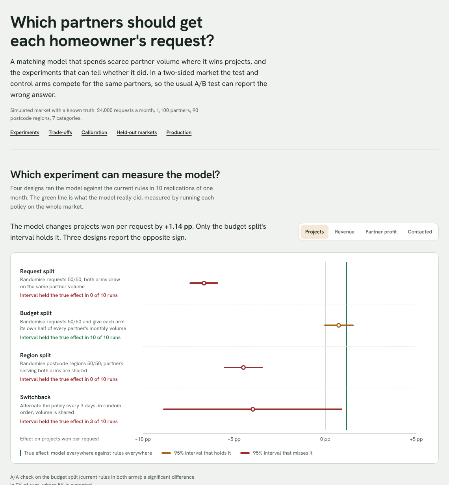

# marketplace-match-allocator

Which partners should get each homeowner's request? This repository builds a first production
matching model for a homeowner marketplace: up to three partners per request, a fixed price per
lead, and partners who set a monthly volume and the regions they serve. It covers the whole path,
from logs to a deployed, monitored model, and the experiment design that can tell whether the
model helped.

The hardest part is the experiment, not the model. Partners take leads from both arms of an A/B
test, so test and control compete for the same capacity. In this simulated market the model wins
**+1.14 percentage points** more projects per request (+11%). A plain request split reports
**−6.66 pp**: the wrong sign, in all 10 replications. A **budget split** gives each arm its own half
of every partner's volume. Its interval holds the true effect in **10 of 10** replications, and an
A/A run on it produced no false positives.



All numbers below are generated by `mma report` into [docs/REPORT.md](docs/REPORT.md) and
`reports/results.json`. The market is simulated, so the true effect of every change is known.

## Results (profile `full`: 24,000 requests a month, 1,100 partners, 90 postcode regions)

**Matching, the same month of requests under each policy:**

| Policy | Requests matched | Projects per request | Lead revenue per request | Partner profit per lead |
|---|---:|---:|---:|---:|
| Current rules (lowest share of volume used goes first) | 74.4% | 10.59% | €142.0 | €50.0 |
| Model, balanced (default) | 86.0% | 11.77% (+11.2%) | €141.4 (−0.4%) | €69.3 (+38.7%) |
| Model, revenue first | 86.3% | 11.43% (+7.9%) | €145.3 (+2.4%) | €65.3 |
| Model, homeowner first | 90.5% | 11.95% (+12.9%) | €139.5 (−1.8%) | €72.9 |
| Model, partner first | 82.3% | 11.70% (+10.5%) | €130.9 (−7.8%) | €74.4 |
| Model without pacing | 78.1% | 10.50% (−0.8%) | €132.9 (−6.4%) | €55.4 |

The weights are presets in `config/matching.yaml`, so a trade-off between homeowners, partners and
revenue is a configuration change that goes through the release gate. Without a price on scarce
partner volume, the model does worse than the rules: it uses up the best partners early in the
month.

**Experiments, 10 replications against the true effect (projects per request):**

| Design | Mean estimate | True effect | 95% interval held the truth |
|---|---:|---:|---:|
| Request split, shared volume | −6.66 pp | +1.14 pp | 0 of 10 |
| Region split | −4.49 pp | +1.14 pp | 0 of 10 |
| Switchback, 3 days | −3.98 pp | +1.14 pp | 3 of 10 |
| **Budget split** | **+0.75 pp** | +1.14 pp | **10 of 10** |

**Models.** LightGBM for "will the partner call within three days" and "will the partner win the
project within forty days", with isotonic calibration on a later time slice. Labels are used only
once they have matured.

| | AUC | Calibration error (ECE) | Before calibration |
|---|---:|---:|---:|
| Contact | 0.724 | 0.013 | 0.020 |
| Win | 0.649 | 0.006 | 0.003 |

**Held-out markets, first run kept as recorded.** Eight markets were written from
[heldout/WRITING_SCENARIOS.md](heldout/WRITING_SCENARIOS.md) by someone who never saw the code:
partner shortage, partner glut, demand concentrated in cities, a wide spread in partner quality,
ignored leads, an expensive lead mix, frequent pauses, and hesitant homeowners. The model won more
projects than the rules in **8 of 8**, with revenue at least 99.5% of the rules'. The budget split's
interval held the true effect in 5 of 8, the request split's in 1 of 8.

**Production path.**
- dbt builds 21 models with 11 tests.
- The online feature store and the warehouse agree on all 16 features of 195,387 logged leads.
- The Airflow DAG runs end to end: landing, dbt build, parity, weekly training, gate and MLflow
  promotion, monitoring.
- Two service instances with eight threads, every partner's volume squeezed to two leads:
  2,158 leads sent, **0 over a partner's volume**, and a retried request returns the same decision.
- Single-thread latency with the model: p50 3.4 ms, p95 4.7 ms.
- All 10 release-gate floors pass.

## How it works

```
logs (requests, matches, calls, wins, partner settings)
  └─ dbt: staging → point-in-time candidates and features → fct_training_pairs (+ tests)
       └─ parity: replay logs through the online feature store, compare every feature
            └─ train: LightGBM contact + win, isotonic calibration → MLflow candidate
                 └─ gate (ECE, AUC, drop vs champion, parity) → champion alias
                      └─ FastAPI /match: eligible partners → calibrated scores → euro objective
                         with a pacing price per partner → reserve volume in Postgres
                           └─ monitoring: PSI drift, calibration on matured labels
```

- **Objective.** Each candidate set is scored in euros. It adds lead revenue, the value of the
  homeowner's project (a second partner adds less than the first), and the partner's expected
  profit, then subtracts a price on each partner's remaining volume. That price comes from dual
  descent against an even monthly schedule. See [ADR 2](docs/adr/0002-a-euro-objective-with-paced-capacity.md).
- **Experiments.** `mma.experiments` assigns arms for the four designs, splits capacity where the
  design says so, and estimates with cluster-robust standard errors. See
  [ADR 1](docs/adr/0001-measure-with-a-budget-split.md).
- **Truth isolation.** Only `mma.sim` and `mma.evaluate` see the simulated truth. Features, models,
  matching, pipeline, serving and monitoring work from logs; `tests/test_isolation.py` checks it.

## Run it

```bash
pip install -e ".[dev]"
pytest -q                                   # unit + pipeline; serving tests need MMA_TEST_DATABASE_URL
mma all --profile quick                     # study, held-out rerun, serving bench, report, gate (minutes)
mma study --profile full && mma heldout --profile full && \
  mma serving --profile full --dsn $MMA_DATABASE_URL && mma report --profile full && mma gate --profile full
scripts/airflow_dag_test.sh                 # the DAG end to end (Airflow 3.1 on PATH)
docker compose run --rm seed && docker compose up api
cd web && npm ci && npm run dev             # the dashboard, from reports/results.json
```

## Limits

- **The market is simulated.** Its structure follows public facts about the business: up to three
  partners per request, a price per lead, partner-set volumes and regions, and about one request
  in ten becoming an order. Prices, partner margins and the behaviour model are assumptions in
  `config/`, not anyone's real data.
- **The budget split is right in sign but low.** It underestimates the effect by about a third
  (target ≤ 25%, missed). Halving every partner's volume makes each arm a smaller market than the
  real one. In the held-out markets its interval missed the truth in 3 of 8, all
  underestimates. The live split also needs an arm column in the reservation table; see ADR 1.
- **Monitoring shows drift** on partner win rate, leads and contact rate between the first months
  of history and the latest week. This comes from the history starting cold, not from a change in
  the market. Each feature's reference window should start once the counters have warmed up.
- **The win model is barely improved by calibration.** Its raw probabilities are already close
  (ECE 0.003), and the calibrated ones are within the gate (0.006 ≤ 0.015).
- **Spark is not used.** A month of logs is a few hundred thousand rows; the dbt SQL would move to
  Spark SQL if the volume needed it.
